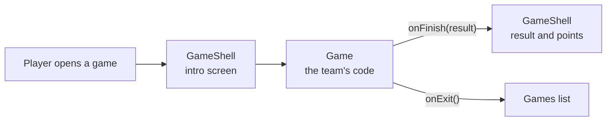

<p align="center">
  
</p>

<h3 align="center" dir="rtl">منصّة ولادز للألعاب التعليمية والتوعوية</h3>

<p align="center">
  Educational and awareness games for the children and young people of Algeria.<br>
  A platform commissioned by the Algerian Ministry of Youth.
</p>

<p align="center">
  
  
  
  
  
  
</p>

<p align="center">
  <a href="#about">About</a> ·
  <a href="#getting-started">Getting started</a> ·
  <a href="#add-a-game">Add a game</a> ·
  <a href="#content-charter">Content charter</a> ·
  <a href="#how-we-work">How we work</a>
</p>

---

## About

WLADZ is a hub of short games that teach through play. Every game covers one of five themes:

| Theme | What children learn |
| --- | --- |
| 🛡️ Prevention | The dangers of drugs and addictions, and everyday dangers |
| 🤝 Civics | Good behaviour, respect, road safety, care for public spaces |
| 📜 History | The history of Algeria |
| 🏛️ Culture | Heritage, traditions and the regions of Algeria |
| 🌙 Values | Islamic and moral values |

- **Arabic first:** the interface is in Arabic, right to left. French is optional.
- **Mobile first:** built for entry-level Android phones, and usable with a mouse and keyboard.
- **Made for children:** kind feedback, no trackers, no chat between children, as little personal data as possible. Parents are the guarantors of each account.
- **One hub, many games:** each game is a separate folder, plugged into the hub through a single contract.

### How a game plugs into the hub



The hub, not the game, is responsible for the points: at most 100 per run (each game sets its own maximum), whole numbers, never negative, and never won by luck (no lottery, wheel or loot box).

## Project status

> **Early prototype.** The foundations are in place. The hub pages and the games are being built.

| Part | Status |
| --- | --- |
| Account API: register, login, logout, current user | ✅ Ready |
| Game contract, `GameShell` (minimal version) and game template | ✅ Ready |
| Hub pages: home, sign-in, dashboard, ranking, videos, contact | 🚧 In progress (some are still empty) |
| Saving points and the ranking | 🚧 In progress |
| Games | 🚧 Built by each game team |

## Tech stack

| Area | Choice |
| --- | --- |
| Framework | [Next.js 16](https://nextjs.org) (App Router, Cache Components) with React 19 |
| Language | TypeScript, strict mode |
| Styles | Tailwind CSS 4, configured in `app/globals.css` |
| Database | SQLite through Node's built-in `node:sqlite` module, no ORM |
| Accounts | Built in: scrypt password hashes, hashed session tokens, HTTP-only cookie |
| Code quality | ESLint 9 with `eslint-config-next` |
| Packages | npm only (no yarn, pnpm or bun) |

## Getting started

You need **Node.js 22.13 or newer** and npm.

```bash
git clone https://github.com/ilyas-ali-benyahia/wladz.git
cd wladz/wladz   # the app lives in the wladz/ folder of the repository
npm ci           # install the exact versions from package-lock.json
npm run dev      # start the app at http://localhost:3000
```

| Command | What it does |
| --- | --- |
| `npm run dev` | Starts the development server |
| `npm run lint` | Checks the code with ESLint |
| `npm run build` | Builds for production (fails until the empty hub pages are filled) |
| `npm run start` | Serves the production build |

**Local data:** the SQLite database is created at `wladz/.data/auth.sqlite` on first use (set `AUTH_DATABASE_PATH` to use another file). Secrets go in `wladz/.env.local`. Git ignores both.

## Project structure

```text
.
├── README.md
├── AGENTS.md, CLAUDE.md          instructions for AI coding agents
├── .github/assets/               images used by this README
└── wladz/                        the Next.js app (run npm commands here)
    ├── app/
    │   ├── page.tsx              home page
    │   ├── login/                sign-in page
    │   ├── dashboard/            the hub: home, games, ranking, videos, contact
    │   │   └── games/
    │   │       ├── _template/    starting point for a new game
    │   │       └── <slug>/       one folder per game, at /dashboard/games/<slug>
    │   └── api/auth/             register, login, logout, me
    ├── components/games/         GameShell, the common frame of every game
    ├── lib/                      database and authentication
    ├── types/game.ts             the game contract
    ├── public/games/<slug>/      images and sounds of each game
    ├── WLADZ_TEAM_PROMPT.md      the team rules
    └── CRITICAL_CHANGES.md       log of changes to the rules
```

## Add a game

1. **Choose a slug:** lowercase ASCII in kebab-case, unique, for example `defi-anti-drogue`. It becomes the folder name and the URL, and it does not change once announced.
2. **Copy the template:** `wladz/app/dashboard/games/_template/` to `wladz/app/dashboard/games/<slug>/`.
3. **Fill in `manifest.ts`:** title, description, theme, age range, learning goals and `maxPointsPerRun` (1 to 100).
4. **Write the game** in `_components/Game.tsx`. Keep the educational content in `_data/`, with a source for every sensitive fact.
5. **Add the assets** to `wladz/public/games/<slug>/`, including a 640×360 `thumbnail.webp`.
6. **Try it:** run `npm run dev`, then open `http://localhost:3000/dashboard/games/<slug>` (this needs the dashboard layout, which is still in progress).

The game receives three props, and that is its only link to the hub:

```tsx
export default function Game({ player, onFinish, onExit }: GameProps) {
  // player:   { firstName, age }
  // onFinish: call it once, at the end, with { score, pointsEarned, completed, durationMs }
  // onExit:   call it when the player leaves before the end
}
```

<details>
<summary><strong>Rules for game code</strong></summary>

- Import only your own folder, `@/types/game`, `@/components/games/GameShell`, `@/components/ui/*` and React.
- Never call `/api/*`, read cookies or store points in `localStorage`. The hub handles the points.
- Style with Tailwind classes or CSS Modules. No global CSS, and no changes to `<html>` or `<body>`.
- Stop every timer, animation frame, listener and sound when the game unmounts.
- A game already made in plain HTML can run in an `<iframe>` from `public/games/<slug>/`.

The full contract is in section 6 of the [team rules](wladz/WLADZ_TEAM_PROMPT.md).

</details>

## Content charter

Everything in WLADZ (text, images, sounds and game mechanics) respects Islam, Algerian culture and national unity. In short:

- **Kind feedback:** a mistake earns encouragement and an explanation, never mockery.
- **No depiction** of the prophets or the Companions.
- **Verified sources:** Quranic verses and hadiths are copied from reliable sources with their references, never quoted from memory. Historical facts are checked against official school textbooks or recognised sources.
- **Nothing harmful:** no gambling, betting or loot boxes, no magic or fortune-telling presented positively, and no positive portrayal of drugs, alcohol or tobacco.

Read section 9 of the [team rules](wladz/WLADZ_TEAM_PROMPT.md) before writing any content.

## Privacy and security

WLADZ is used by minors, so every part of the code follows these rules:

- Only the fields of the user schema are collected (section 7.1 of the rules). The parent's phone number is never shown publicly.
- No trackers, analytics or advertising, and no chat between children.
- The ranking shows only the first name, the initial of the last name and the points.
- Secrets, `.env` files and the database never go into Git.

## How we work

- Work on `main` (or on a branch for big work), and run `git pull --no-rebase` before every push.
- Never force-push, and never rewrite history that is already pushed.
- Stay in your zone: a game team changes only its own game folders. Hub & Core owns the rest.
- Commit messages follow `<type>(<scope>): <description>`, for example `feat(game-<slug>): <description>`.
- Any change that breaks a rule (a new dependency, a new route, a change to the game contract) gets an entry in [`CRITICAL_CHANGES.md`](wladz/CRITICAL_CHANGES.md).
- Commits and pull requests are signed by the developer only, with no AI co-author lines.

The full rules are in [`wladz/WLADZ_TEAM_PROMPT.md`](wladz/WLADZ_TEAM_PROMPT.md).

## Team

WLADZ is built by several groups working in parallel: **Hub & Core** (home page, hub, accounts, points and ranking) and one group per game. The platform is commissioned by the Algerian Ministry of Youth.
